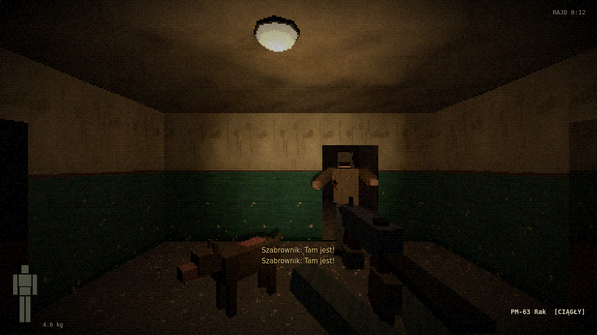
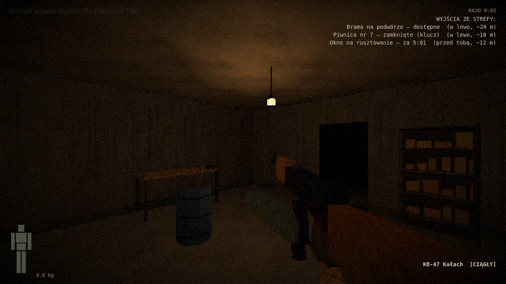
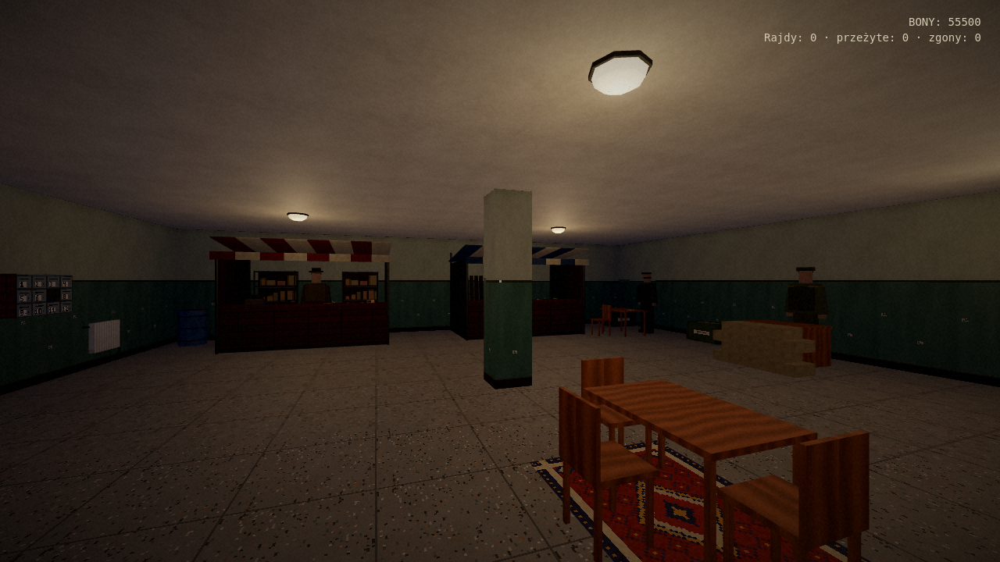
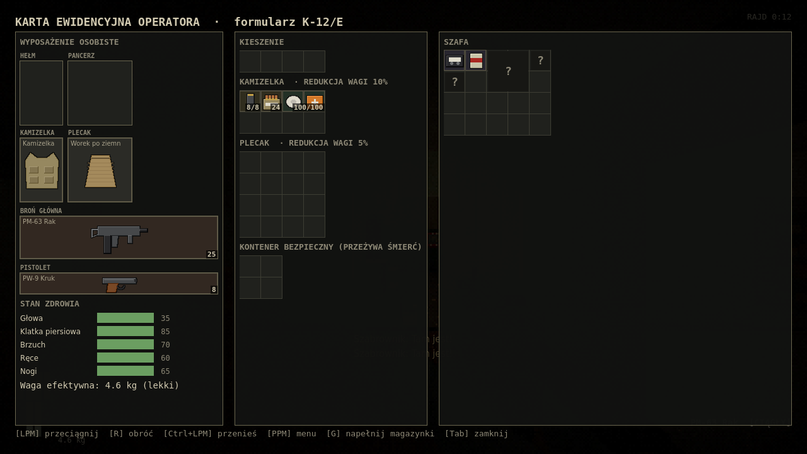

# Strefa K-12

Taktyczny shooter PvE z mechaniką extraction, w pierwszej osobie, w stylu low poly PS1.
Alternatywny blok wschodni, strefa kwarantanny wokół kompleksu badawczego, 12 lat po zamknięciu.
Wchodzisz do losowo składanej strefy, zbierasz łup i albo się ewakuujesz, albo tracisz wszystko.

> Stan: **pierwsze grywalne demo** – biom 1 (Blokowisko), pełna pętla baza → rajd → raport.
> Szczegóły: [docs/STAN_DEMO.md](docs/STAN_DEMO.md).

| | |
| --- | --- |
|  |  |
|  |  |

## Uruchomienie

**Gotowa gra:** `StrefaK12_demo_Windows.zip` (albo wersja Linux) – rozpakuj i uruchom `StrefaK12.exe`. Nie trzeba instalować Godota. Build można też zrobić samemu (sekcja Budowanie).

**Ze źródeł:** Godot **4.6** (renderer Compatibility). Otwórz folder w menedżerze projektów, poczekaj na import, F5.

## Sterowanie

| Klawisz | Akcja |
| --- | --- |
| WSAD, Shift, Ctrl, Spacja | ruch, bieg, kucanie, skok |
| Q / E | wychylenie zza osłony |
| LPM / PPM | strzał / celowanie przez przyrządy |
| R | przeładowanie (przytrzymaj: szybkie – nowy magazynek wybija stary, obrzyn wyrzuca łuski szarpnięciem); przy zacięciu – usunięcie zacięcia (klepnięcie w magazynek i zamek / rączka zamka do oporu); strzał w trakcie ładowania obrzyna – zatrzaśnięcie luf |
| B / T | tryb ognia / sprawdzenie amunicji: zerknięcie na okienka magazynka (ile naboi widać), w obrzynie – uchylenie luf i rzut oka na komory |
| 1 / 2 / 3 | broń główna / pistolet (drugie wciśnięcie: pistolet z latarką) / sama latarka |
| F | interakcja (przeszukaj, rozmawiaj, otwórz) |
| Tab | panel operatora; „Otwórz” przy plecaku/kontenerze: postać zdejmuje go i rozkłada przed sobą (sloty we wnętrzu); w sklepie Tab zamyka |
| Tab, Tab | szybkie zerknięcie na kamizelkę (ładownice pod ręką) |
| G | w ekwipunku: napełnij magazynki z amunicji luzem; w rajdzie: rzut granatem (kucając – po podłodze) |
| L | latarka: wyjmij do lewej ręki (z pistoletem albo samą) / włącz–wyłącz; z latarką taktyczną na broni włącza ją |
| O | lista wyjść z kierunkiem i odległością |
| 4–9 | pasek szybkiego dostępu: leki z kamizelki i kieszeni (układa się sam) |
| H | spójrz na zegarek (zdrowie na tarczy) |
| J | obejrzyj broń z bliska, zakładanie i zdejmowanie dodatków |
| X | przerwij leczenie lub napełnianie (przerywa też strzał i zmiana broni) |
| Esc | pauza (w rajdzie czas płynie dalej); Ustawienia: czułość, FOV, głośność, kołysanie, skala renderu, cienie, oś Y, wskazówki, FPS |
| F1 | plansza ze sterowaniem |

Latarka, mapa i kompas działają tylko na slotach wyposażenia (pas + 0–2 z kamizelki). Mapa daje odległości
do wyjść w liście [O], kompas – pasek kierunków u góry ekranu. Amunicja luzem to garść (1x1), większy stos robi się
pudełkiem (2x3). Siatka jest drobna (dawna kratka to 2x2 nowe): zegarek czy bandaż zajmują jedną kratkę,
magazynek KB-47 2x4, KB-47 8x3 – małe rzeczy upycha się między dużymi. Kamizelki i plecaki mają przegródki
(osobne ładownice i kieszenie). Stare zapisy przeliczają się same (pozycje x2, co nie pasuje – układane na nowo).
Ikony przedmiotów to szkice jak z instrukcji obsługi z lat 70–80: rysunek tuszem z modelu 3D na pożółkłym, wyrwanym
skrawku papieru (cienie paskami jak w ilustracjach technicznych, odnośniki z numerami, „Rys.” / „Рис.”, linia
wymiarowa przy broni, na części rysunków wyblakła pieczątka – „ZATWIERDZONO”, „ОТК”, „ГОСТ 1050-74”…). Papier:
szarozielony – sprzęt wojskowy, pożółkły – łup i rzeczy cywilne, biały – środki opatrunkowe. Generowanie:
`godot --path . res://tests/render_ikon.tscn --rendering-driver opengl3 -- /tmp/ik` (z xvfb), potem
`python3 narzedzia/ikony_szkic.py /tmp/ik`.

W ekwipunku: przeciąganie myszą, **R** obraca, **Ctrl+LPM** przenosi (w rajdzie kolejka – dłoń przekłada po kolei),
**Shift+LPM** dzieli stos na pół (w rajdzie każde przełożenie robi dłoń – trwa, a trafienie w trakcie wytrąca przedmiot), **PPM** menu (użyj, rozładuj, napełnij, wyjmij magazynek, załóż, wyrzuć, podziel).
PPM na broni: **Wyczyść** (zestaw do czyszczenia – brudna broń zacina się częściej); PPM na metalowym przedmiocie:
**Owiń taśmą** (przestaje brzęczeć w biegu). Szabrownicy zbierają leżące rzeczy i okradają ciała – nie zostawiaj
plecaka bez opieki.
Plecak: **Zdejmij** – postać kładzie go przed sobą zapiętego, potem otwierasz konkretne kieszenie myszą: element, za który
trzeba chwycić (klamra, suwak, brzeg klapy), lekko się świeci, a pod kursorem jaśniej – chwytasz go i przeciągasz
(klamrę wystarczy kliknąć; szybko – głośno). Stan i postęp otwierania widać na samej kieszeni. Koniec ruchu kończy krok dźwiękiem, następny uchwyt chwytasz osobno; zapinasz tak
samo, chwytając uchwyt otwartej kieszeni. Kieszenie zostają takie, jak je zostawisz – otwarte gubią zawartość w biegu, przy skoku i trafieniu.
**Załóż** zakłada plecak (otwarte kieszenie zostają otwarte). W ustawieniach: „proste otwieranie” – klik zamiast gestu. Kontener bezpieczny tak samo
(**Wyjmij kontener**, potem zatrzaski i wieko).
Szafki, szuflady i skrzynie otwiera się w świecie (**F**), zawartość odkrywa się stopniowo – po ciemku wolniej.
Ciała przeszukuje się po kieszeniach; pancerz i hełm z ciała zdejmuje się kliknięciem (trwa). Zamknięte na kłódkę
skrzynie i szafki wyłamuje się (z kombinerkami lub kluczem nastawnym szybciej). Przytrzymany ruch przy rozłożonym
plecaku – zrywasz się i plecak zostaje na ziemi (podejdź i **F**, żeby go założyć). Amunicję upuść na magazynek, żeby go napełnić
(nabój po naboju, z kółkiem postępu), a magazynek na broń, żeby go włożyć. Lek upuszczony na część ciała
w panelu zdrowia leczy właśnie ją.
Głód i pragnienie (paski w panelu ciała) spadają w rajdzie – jedzenie i picie z menu **PPM** (Zjedz / Wypij).
Osaczony wróg potrafi się poddać: podejdź (**F**) – odda łup, za 300 bonów powie, gdzie wyjście, a jego ludzie zawrą
rozejm. Zlecenia bierze się u Pośrednika (najwyżej dwa naraz).
Broń ma bezwładność, przy ścianie lufa się cofa i opada (wtedy nie strzelisz). Celując w miejscu przy parapecie,
meblu albo krawędzi ściany opierasz broń („podparta” pod celownikiem) – mniejszy odrzut i drżenie.
Drzwi: **F** otwiera i zamyka (klamka, skrzypienie, słychać to z daleka); **kucając F** uchyla je cicho na szparę
(i tak samo cicho zamyka). Zamknięte na klucz otwiera się wytrychem (cicho, kilka sekund) albo wyważa kopniakami –
głośno, metalowe dłużej. Wrogowie otwierają drzwi po drodze, a zamknięte na klucz wyważają. Stań nieruchomo przy
zamkniętych drzwiach, żeby podsłuchać, co jest za nimi (przez skrzydło słychać lepiej niż przez mur). Drewniane
drzwi kula przebija, metalowe nie.
Przeładowania są pokazane krok po kroku: obrzyn łamie się na zawiasie, lewa dłoń wyciąga łuski z komór i odrzuca je,
sięga do kieszeni po naboje, wsuwa je i zatrzaskuje lufy; magazynek KB-47 wychyla się na zaczepie, PM-63 i PW-9 wysuwa
się z chwytu, a przy pustej komorze dłoń przeciąga rączkę zamka / zamek. Podniesiona broń trafia do pustego slotu broni.
Budynek ma piętro – wchodzi się klatką schodową. Strop jest lity (0,6 m żelbetu), więc kule, odłamki ani wzrok
nie przechodzą między kondygnacjami; jedyna droga w górę i w dół to schody (wrogowie też z nich korzystają).
Dodatek (tłumik, latarka taktyczna, hamulec) upuszczony na broń montuje się w terenie z animacją; zdejmuje się z menu
**PPM** na broni. Kolimator, lunetę i chwyt montuje się tylko przy stole roboczym w schronie (podejdź i wciśnij **F**). Przedmiot upuszczony poza oknami ekwipunku ląduje na podłodze dokładnie pod kursorem (w zasięgu ręki; dalej – wyrzut), **Del** na wskazanym – pod nogi.
Przy otwartym ekwipunku w terenie rzeczy leżące w zasięgu ręki podświetlają się pod kursorem – chwytasz je myszą i przeciągasz do plecaka, kieszeni albo slotu.
Podniesiony pancerz, hełm, kamizelka czy plecak zakłada się od razu, jeśli slot jest pusty. 1x1 zajmuje tylko drobnica (garść naboi).
Zabici padają jako ragdolle; zwłoki przeszukuje się, patrząc na dowolną część ciała, a przeszukiwane ciało lekko się podświetla.
Ikony rysowane są jak karty z dokumentacji: kolor papieru i znaki wg kategorii (broń – pieczątka ОДОБРЕНО, amunicja – szablon kalibru,
medykamenty – krzyż, żywność i picie – metka z ceną, narzędzia – blueprint, rupiecie – gazeta).

## Pętla gry

1. **Placówka** (chodzona w pierwszej osobie, bez ładowania między częściami):
   - **kryjówka** – twój betonowy boks. Meble kupujesz u Kwatermistrza i stawiasz pod **[B]** (podgląd pod celownikiem,
     **R** / kółko obraca, **LPM** stawia, **PPM** anuluje; na postawionym meblu **LPM** przestawia, **X** chowa do magazynu).
     Szafki, regały, skrzynie, szafa, biurko i lodówka powiększają skrytkę (start: 16 rzędów). Stół roboczy pozwala montować
     celowniki i chwyt, prycza leczy połowę ran raz po każdym powrocie, a kuchenka podaje posiłek na ciepło (sytszy, bez pragnienia);
   - **korytarz** do **recepcji** – stragany Zbrojmistrza, Medyka, Pośrednika i Kwatermistrza, przedstawiciele trzech frakcji
     i śluza do strefy;
   - **frakcje** (Szabrownicy, Najemnicy, Wojsko) – reputacja od −100 do 100. Zabity członek frakcji to −5 u niej i +1 u pozostałych;
     ich zlecenia dają bony i reputację. Lepszy sprzęt (kl. 4, BP, tłumiki, celowniki, plecak wojskowy) jest u nich od progu
     reputacji, ceny spadają do −15%. Przy wysokiej reputacji ich oddziały nie strzelają pierwsze (rozejm do twojego strzału);
     przy −30 nie handlują;
   - leczenie u Medyka, ubezpieczenie u Pośrednika, darmowy zestaw startowy, gdy nie masz broni (z przydziału – nie do sprzedania).
2. **Rajd**: losowa sieć szerokich korytarzy z pomieszczeniami bloku oddzielonymi grubym murem (mieszkania, kuchnie, piwnice, magazyny, warsztaty),
   szabrownicy i najemnicy z taktycznym AI, pełzacze (mutanty chodzące po ścianach), łup w szafkach i na zwłokach.
3. **Wyjścia**: brama (zawsze), piwnica nr 7 (na klucz z rajdu), okno na rusztowanie (tylko w oknie czasowym).
4. **Raport urzędowy**: przeżycie albo zgon, z komunikatem zależnym od przyczyny i dopiskami z przebiegu rajdu.

## Struktura projektu

| Folder | Zawartość |
| --- | --- |
| `scenes/` | sceny: menu, baza, rajd, raport (treść budowana w kodzie) |
| `scripts/autoload/` | `Dane` (baza przedmiotów), `Gra` (stan, zapis), `Sterowanie`, `Dzwiek`, `PsxMaterialy` |
| `scripts/core/` | przedmiot, siatka, ekwipunek (waga z redukcją), ciało i rany, balistyka, modele, widok 3D |
| `scripts/gracz/` | gracz (ruch, postawy, leczenie, interakcje) i broń (strzelanie, przeładowania) |
| `scripts/ai/` | przeciwnicy ludzcy, oddziały, fauna |
| `scripts/swiat/` | generator biomu, pojemniki z łupem, wyjścia, efekty, migające lampy |
| `scripts/ui/` | HUD, ekran ekwipunku, handel, menu pauzy, sceny |
| `assets/dane/` | `przedmioty.json` (przedmioty, tabele łupu, frakcje), `meble.json` |
| `assets/` | tekstury, modele `.glb`, ikony, dźwięki, czcionki |
| `narzedzia/` | generatory assetów w Pythonie (tekstury, modele, meble, ikony, dźwięki) |
| `tests/` | testy automatyczne |
| `shaders/` | shader PS1 (drgające wierzchołki, afiniczne tekstury) i post-process (dithering) |

Wszystkie assety są generowane kodem: `python3 narzedzia/generuj_tekstury.py`, `generuj_ikony.py`,
`generuj_dzwieki.py`, a w katalogu `narzedzia/`: `generuj_modele.py` i `generuj_meble.py`.
Nowe przedmioty dodaje się w `assets/dane/przedmioty.json` (ikona: `generuj_ikony.py`).

## Testy

```
godot --headless --path . res://tests/sprawdz.tscn            # parsowanie wszystkich skryptów
godot --headless --path . res://tests/test_ekwipunek.tscn     # siatki, stosy, waga, zapis
godot --path . res://tests/test_ui.tscn                       # przeciąganie w ekwipunku
godot --headless --path . res://scenes/rajd.tscn -- --test --ziarno 31   # generator + spójność nawigacji
godot --headless --path . res://scenes/rajd.tscn -- --walka   # starcie z oddziałem
godot --headless --path . res://scenes/rajd.tscn -- --test --sluch   # kto reaguje na strzał ze środka mapy
godot --path . res://scenes/rajd.tscn -- --zrzuty <katalog>   # zrzuty ekranu
godot --headless --path . res://scenes/rajd.tscn -- --test_bron   # klawisze broni i latarki
godot --path . res://scenes/rajd.tscn -- --posterunek <katalog>  # posterunki wojska i korytarze
godot --path . res://scenes/rajd.tscn -- --postacie <plik.png>   # przeciwnicy w pozach
godot --path . res://scenes/rajd.tscn -- --vm <katalog>          # fazy przeładowania
godot --path . res://scenes/baza.tscn -- --test_kryjowki         # meble, skrytka, sen, kuchenka, reputacja, rozejm
godot --path . res://scenes/baza.tscn -- --zrzuty <katalog>      # kryjówka, recepcja, tryb budowy, handel
godot --path . res://scenes/rajd.tscn -- --ekonomia --ziarno 3   # sonda balansu: łup w meblach i sprzęt wrogów na mapie
```

Testy używają osobnego pliku zapisu i nie ruszają zapisu gracza.

## Budowanie

```
godot --headless --path . --export-release "Windows Desktop" build/windows/StrefaK12.exe
godot --headless --path . --export-release "Linux" build/linux/StrefaK12.x86_64
```

Wymaga szablonów eksportu Godota 4.6.1.

## Licencje

Kod i assety: autorzy projektu. Czcionki DejaVu: licencja w `assets/fonty/LICENCJA.txt`.
